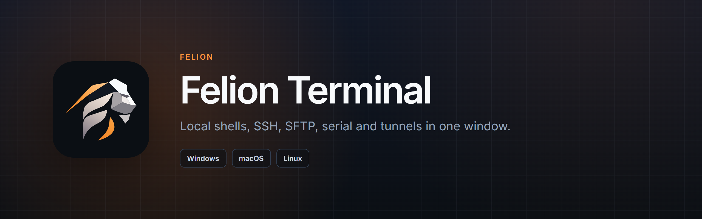
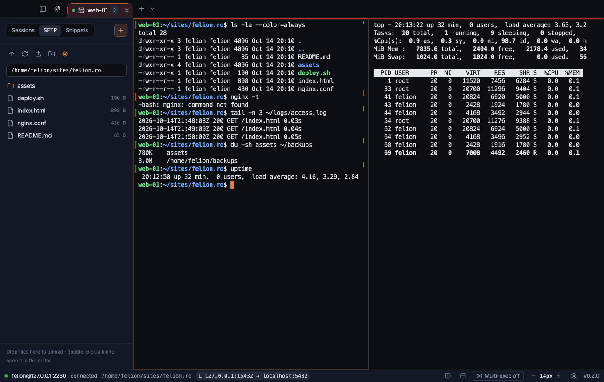
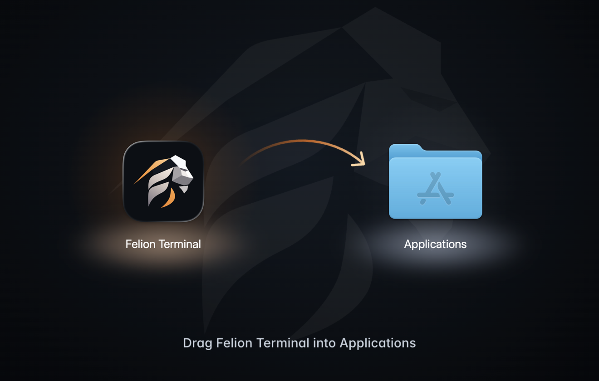
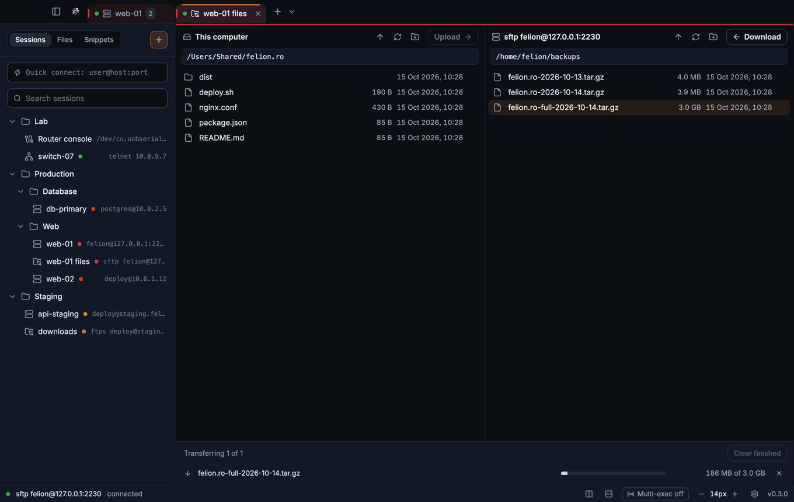
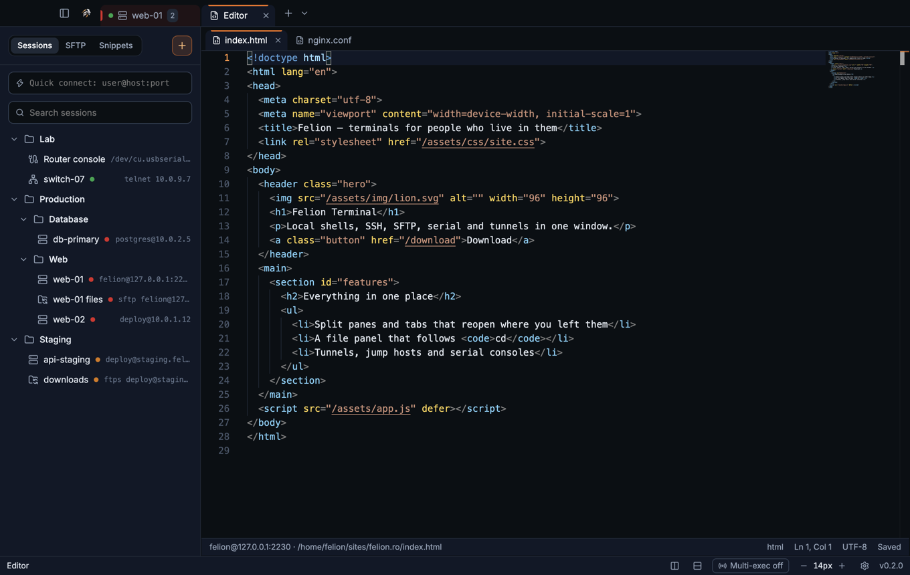
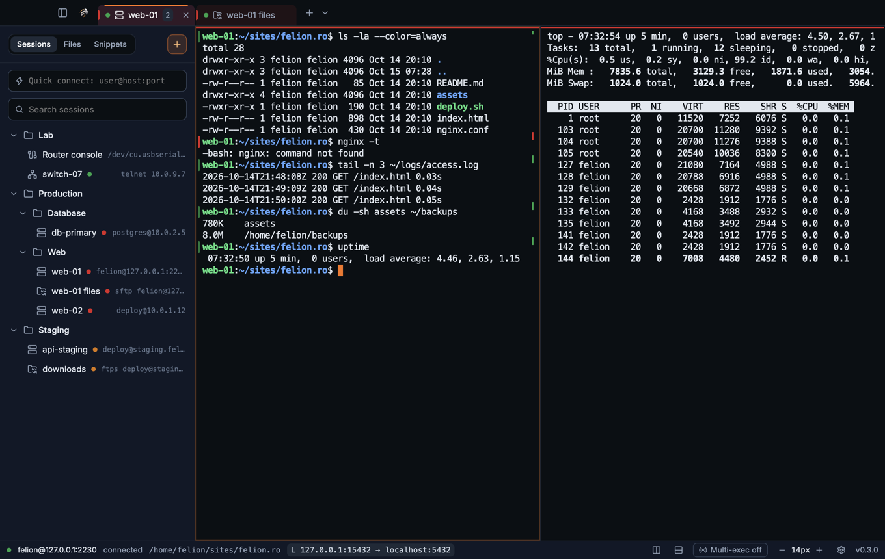
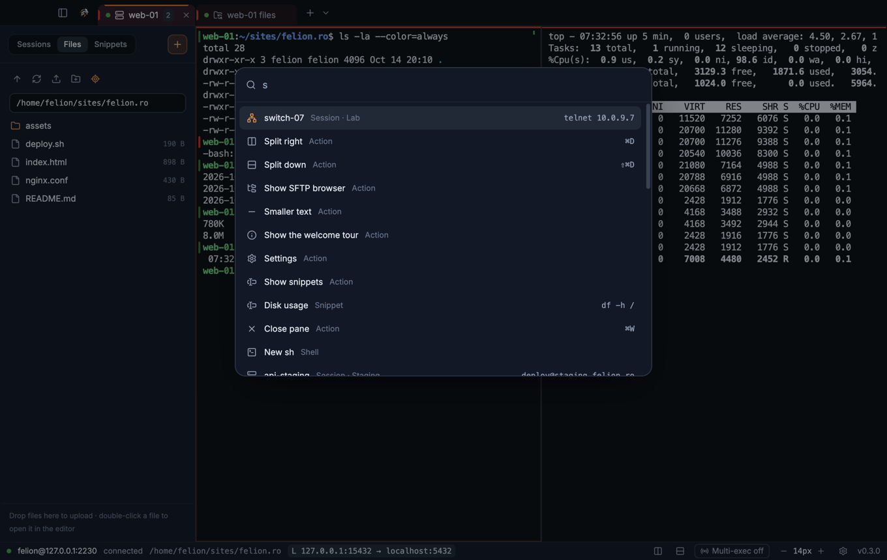
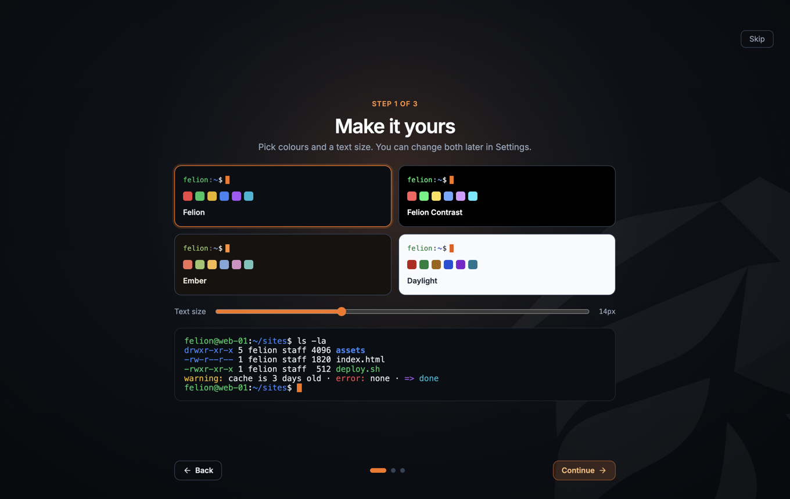
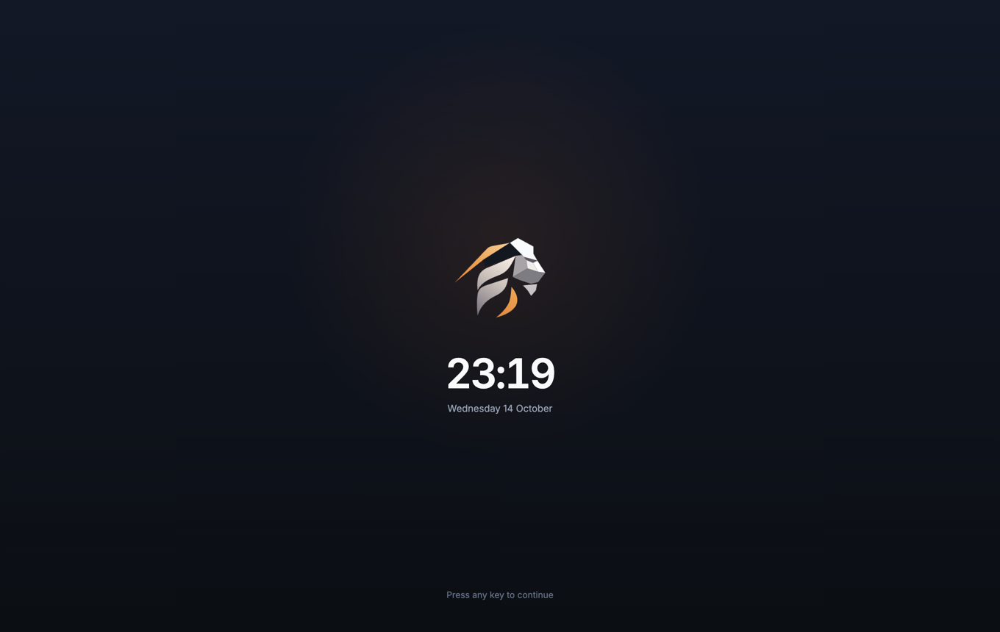

  

  
  
  

  <b>Felion Terminal</b> is a fast, focused terminal for people who live on servers. 
  Your shells, SSH sessions, files, tunnels and serial consoles, side by side, in one calm window.

  <a href="https://github.com/felion-labs/FL-Terminal_updates/releases/latest"><b>⬇&nbsp;&nbsp;Download the latest version</b></a>

  

---

## Download

Open the **[latest release](https://github.com/felion-labs/FL-Terminal_updates/releases/latest)** and pick the file for your system:

| System | File |
|---|---|
| **Windows** 10 and 11 | `FelionTerminal-Setup-<version>.exe` installs it; `FelionTerminal-Portable-<version>.exe` runs without installing |
| **macOS**, Apple silicon (M1 and later) | `FelionTerminal-<version>-mac-arm64.dmg` |
| **macOS**, Intel | `FelionTerminal-<version>-mac-x64.dmg` |
| **Linux** | `FelionTerminal-<version>-linux-x86_64.AppImage` runs anywhere; `FelionTerminal-<version>-linux-amd64.deb` for Debian and Ubuntu |

<table>
  <tr>
    <td width="50%"></td>
    <td width="50%" valign="top">
      <b>Installing</b>
      <ul>
        <li><b>macOS</b>: open the <code>.dmg</code> and drag the lion into Applications.</li>
        <li><b>Windows</b>: run the installer; it adds a Start menu entry and can be removed from Settings → Apps.</li>
        <li><b>Linux</b>: make the AppImage executable (<code>chmod +x</code>) and run it, or <code>sudo apt install ./FelionTerminal-…deb</code>.</li>
      </ul>
      <b>First start</b>: until the builds carry a code-signing certificate, the system asks once.
      On Windows choose <b>More info → Run anyway</b>; on macOS open <b>System Settings → Privacy &amp; Security</b>
      and click <b>Open Anyway</b>.  
      <b>Checking a download</b>: every release has a <code>SHA256SUMS.txt</code>. Compare with
      <code>shasum -a 256 &lt;file&gt;</code> (macOS, Linux) or <code>Get-FileHash &lt;file&gt;</code> (PowerShell).
    </td>
  </tr>
</table>

---

## What you get

<table>
  <tr>
    <td width="50%" valign="top">
      <h3>Terminals</h3>
      <ul>
        <li>Tabs and split panes; tabs and splits reopen where you left them.</li>
        <li><b>Quick terminal</b>: a hotkey drops a shell from the top of the screen in any app.</li>
        <li><b>Host colours</b>: mark production in red and every tab and pane on it says so.</li>
        <li><b>Command marks</b>: a green or red mark by every command's result; jump between them.</li>
        <li>Search, multi-exec into every pane at once, notifications when a long command ends.</li>
      </ul>
    </td>
    <td width="50%" valign="top">
      <h3>Servers</h3>
      <ul>
        <li><b>SSH</b> with password, key, agent and two-factor prompts, jump hosts, agent and X11 forwarding.</li>
        <li>Host keys checked on first use; a changed key stops the connection with a clear warning.</li>
        <li>Port forwarding: local, remote and SOCKS.</li>
        <li><b>Serial</b> consoles and <b>Telnet</b> for network gear.</li>
        <li><b>rz / sz</b> (ZMODEM) file transfers right in the terminal.</li>
      </ul>
    </td>
  </tr>
  <tr>
    <td valign="top">
      <h3>Files</h3>
      <ul>
        <li>A file panel next to the terminal that follows <code>cd</code>.</li>
        <li><b>SFTP, FTP and FTPS</b> sessions open a two-pane file manager with a transfer queue.</li>
        <li>A built-in editor: open a file on the server, save it back over the same connection.</li>
      </ul>
    </td>
    <td valign="top">
      <h3>Yours</h3>
      <ul>
        <li>Saved sessions in folders, snippets, and a command palette for everything.</li>
        <li>Four colour schemes, from dark to light.</li>
        <li>Passwords kept in your system keychain; export and import as one encrypted file.</li>
      </ul>
    </td>
  </tr>
</table>

---

## A closer look

<table>
  <tr>
    <td width="50%"></td>
    <td width="50%"></td>
  </tr>
  <tr>
    <td align="center"><b>File manager</b>: this computer and the server side by side.</td>
    <td align="center"><b>Editor</b>: server files in tabs, saved back where they came from.</td>
  </tr>
  <tr>
    <td></td>
    <td></td>
  </tr>
  <tr>
    <td align="center"><b>Sessions</b>: folders, colours, search and quick connect.</td>
    <td align="center"><b>Command palette</b>: every action, session and snippet, one search away.</td>
  </tr>
  <tr>
    <td></td>
    <td></td>
  </tr>
  <tr>
    <td align="center"><b>Welcome tour</b>: colours, text size and your servers in under a minute.</td>
    <td align="center"><b>Idle screen</b>: the lion keeps watch while your sessions keep running.</td>
  </tr>
</table>

---

## Updates

The app looks at the latest release in this repository shortly after it starts and every six hours.
When there is a newer version it tells you and offers the right file for your system; nothing is
downloaded or installed until you choose to. You can check by hand, or turn the checks off, in
**Settings → About**.

This repository holds the releases only. Each one is published here automatically when a new
version is built, with its notes and checksums.

---

   
  Felion Terminal · Felion Labs

